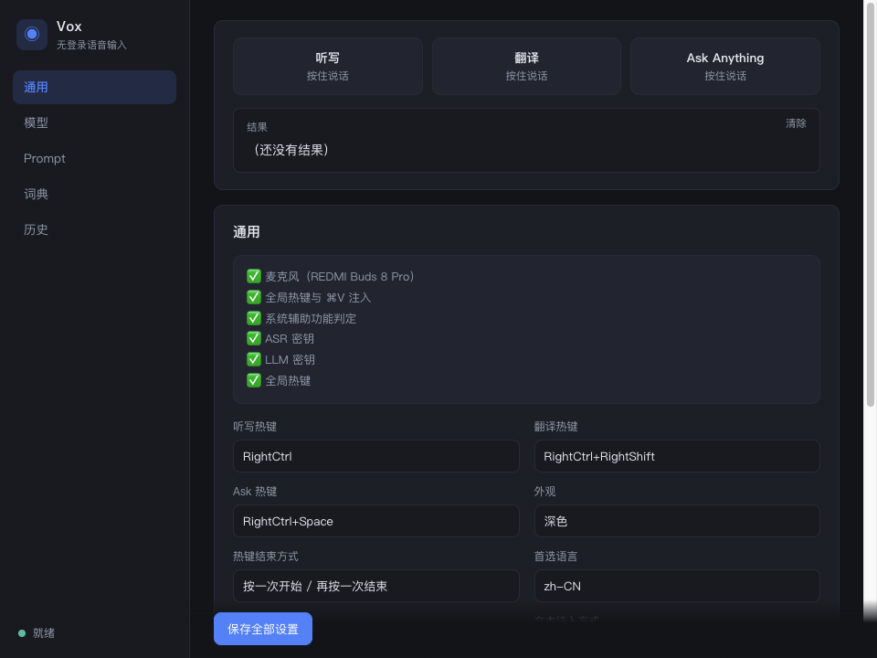
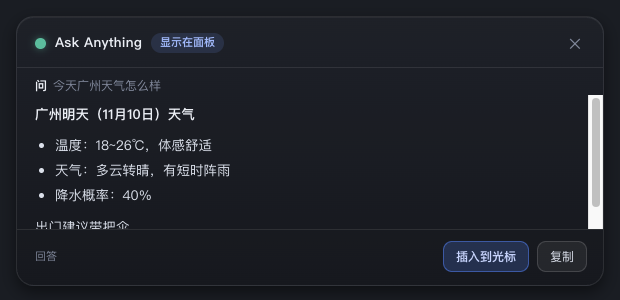
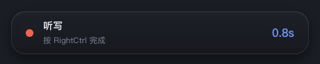

<div align="center">

# Vox

**macOS 上的无登录语音输入工具** —— 听写 / 翻译 / 问答

Rust 核心 + Tauri v2 外壳 · 模型走你自己的接口 · 数据只留本机

[](LICENSE)


</div>

---

## 是什么

一个常驻菜单栏的 macOS 应用，按一下热键说话，松手（或再按一次）就把整理好的文字插进光标处。

- **没有账号、没有订阅、没有云同步** —— API key 只存在你自己的机器上
- **模型层可换** —— `base_url` / `model` / `prompt` 全在设置里改
- **纯 Rust 核心** —— 录音、ASR、LLM、注入全在本地进程里，可脚本化调用

## 界面

<table>
<tr>
<td width="50%"><br><sub>设置界面：热键、模型、Prompt、词典、历史</sub></td>
<td width="50%"><br><sub>问答：回答直接显示在浮窗面板里</sub></td>
</tr>
<tr>
<td colspan="2" align="center"><br><sub>录音时：主屏底部居中的紧凑浮条</sub></td>
</tr>
</table>

## 功能

| | |
|---|---|
| 🎙 **听写** | 口语 → 整理成能直接用的文字（去口头禅、自我更正整体替换、自动分点分段） |
| 🌐 **翻译** | 说中文出外语，目标语言可配 |
| 💬 **问答** | 能带着**光标上下文**提问，也能真的查实时数据（模型自己调工具） |
| ⌨️ **三种热键** | `RightCtrl` 听写 / `RightCtrl+RightShift` 翻译 / `RightCtrl+Space` 问答，**结束键统一是 `RightCtrl`** |
| 📋 **个人词典** | 本地词条替换，也能提示模型用正确的写法 |
| 🔒 **密钥加密存储** | XChaCha20-Poly1305 加密存本地文件，**不进系统钥匙串** |
| 🎨 **外观** | 深色 / 浅色 / 跟随系统 |
| 🔇 **录音时静音** | 录的时候把其它声音压掉，不串进麦克风 |
| 📦 **CLI 同源** | `vox dictation` / `vox ask` / `vox hotkey`，和 GUI 共用同一套核心 |

## 快速开始

**直接用**（Release 页下 `Vox-0.1.0-macOS.zip`）：

```bash
unzip Vox-0.1.0-macOS.zip
mv Vox.app /Applications/
open -a Vox
```

**自己编译**：

```bash
git clone https://github.com/SaulLockYip/vox.git
cd vox
bash tools/package-macos.sh          # 编译 → 打包 → ad-hoc 签名 → 安装到 /Applications
open -a Vox
```

> **首次打开被拦？** 包是 ad-hoc 签名的（没有付费的开发者证书），
> Gatekeeper 可能拦一下 —— 这是签名问题，**两种方式自己解决**：
>
> ```bash
> # 方式一：右键点 Vox.app → 选「打开」→ 再点「打开」
> # 方式二：命令行去掉隔离标记
> xattr -dr com.apple.quarantine /Applications/Vox.app
> ```
>
> 之后每次启动都不再需要处理。想彻底没有这个提示，就自己拿一张
> [Apple Developer ID](https://developer.apple.com/programs/) 证书重新签名。

> **首次使用需要授权**：系统设置 › 隐私与安全性 › 辅助功能 › 勾选 **Vox**。
> 全局热键监听和「把文字插进光标」都依赖这个权限。

在设置页填好 ASR / LLM 的 key（`vox secret set stt|llm` 也可以），按 `RightCtrl` 试试。

## 它是怎么工作的

```
按键 → 采集 16kHz 单声道 → ASR 转写 → 按模式渲染 prompt → LLM 整理
     → 词典替换 → 剪贴板 + ⌘V 注入光标
```

- **听写 / 翻译**：结果直接写进光标处
- **问答**：结果**由模型自己决定**放在哪 —— 显示在面板里，还是写进文档：

  | 模型输出 | Vox 的动作 |
  |---|---|
  | `[[deliver: reply]]` | 显示在浮窗面板里（默认） |
  | `[[deliver: insert]]` | 写进光标处 |
  | `[[deliver: replace]]` | 替换选中的内容 |
  | `[[open: URL]]` | 打开网址/应用（**直接执行，不弹确认框**） |

  所以你只要正常提问：「帮我打开 B 站」→ 模型回答「好的，正在为你打开…」并**直接把 B 站打开**；
  「明天北京天气怎么样」→ 模型自己 `curl wttr.in` → 答案里带真实数据。

## 配置

| 位置 | 内容 |
|---|---|
| `~/Library/Application Support/Vox/settings.toml` | 配置（模型、base_url、prompt、热键…） |
| `~/Library/Application Support/Vox/secrets.json` | 密钥（加密，0600） |
| `~/Library/Application Support/Vox/vox.db` | 历史 + 个人词典（SQLite） |
| `~/Library/Application Support/Vox/tmp/` | 临时录音 |

改内置 prompt 后，老配置里存的旧默认值会**自动迁移**；你自己改过的 prompt **一律不动**。

## 命令行

```bash
vox doctor              # 体检：配置 / 密钥 / 麦克风 / 权限
vox dictation           # 录音（回车停止）→ 整理 → 插入光标
vox translate           # 翻译
vox ask                 # 问答
vox hotkey              # 常驻热键模式
vox secret set stt      # 从标准输入读密钥（不留在 shell history）
vox audio               # 蓝牙耳机卡在单声道时，把音质推回 A2DP
```

## 开发

```bash
cargo test --workspace        # 113 个测试
cargo build --release         # release 构建
bash tools/package-macos.sh   # 打包 + 签名 + 安装
```

`tools/` 里还有几个让开发变舒服的小工具：

| 脚本 | 用途 |
|---|---|
| `fake-server.py` | 本地假 ASR/LLM，让全链路可**确定性复现**（真实录音不外传） |
| `post-key.py` | 注入按键事件，自动验证全局热键 |
| `audio-device.py` | 看/切默认音频设备（排查蓝牙耳机音质） |

### 目录

```
crates/
  core/       配置模型、模式定义、跨进程锁      providers/  ASR + LLM 客户端
  audio/      采集、重采样、WAV                pipeline/   模式编排、prompt、工具
  storage/    SQLite                           macos/      热键、注入、CoreAudio
  app/        门面 crate                        cli/        命令行版
src-tauri/    Tauri v2 外壳                    ui/         前端（纯静态）
```

## 已知限制

- 问答的 `replace` 目前等价于 insert（靠粘贴顺带替换选区）
- 还没做的：免提双击、合盖停止、富文本插入、词典自动学习、个性化、多语言 UI

## License

[MIT](LICENSE)
